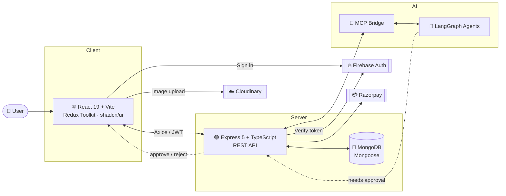

<div align="center">

# 🤖 AgentAI

### Autonomous AI agents with a human in the loop.

Build, chat with, and supervise LangGraph-powered agents that can send emails, schedule events and publish to Instagram, **only after you approve**.

<br />


[Features](#-features) •
[Architecture](#-architecture) •
[Tech Stack](#-tech-stack) •
[Getting Started](#-getting-started) •
[API Overview](#-api-overview) •
[Roadmap](#-roadmap) •
[Contributing](#-contributing)

</div>

---

## 📖 Overview

**AgentAI** is a full-stack platform for running AI agents you can actually trust with real-world actions. A React frontend gives users a chat interface to talk to agents; an Express + TypeScript backend handles authentication, billing and persistence, and bridges to **LangGraph** agents through the **Model Context Protocol (MCP)**.

When an agent wants to do something consequential (send an email, create a calendar event, publish an Instagram post), it pauses and asks for **explicit user approval** before executing.

<!--
  📸 Add a screenshot or GIF here:
  <p align="center"></p>
-->

---

## ✨ Features

| | Feature | Description |
|---|---|---|
| 💬 | **Real-time chat** | Talk to agents with agent selection and persistent conversation context |
| 🧠 | **LangGraph orchestration** | Multi-step agent workflows connected to the backend via MCP |
| ✅ | **Human-in-the-loop approvals** | Review and approve emails, calendar events and Instagram posts before they run |
| 🖼️ | **Image handling** | Upload images in chat, stored through Cloudinary |
| 🔐 | **Secure authentication** | Google and Facebook sign-in via Firebase, with Firebase Admin and JWT on the server |
| 💳 | **Payments & credits** | Razorpay integration with a usage-based credit system |
| 🔌 | **Integrations** | Dedicated API surface for connecting external services |
| 🎨 | **Modern UI** | Tailwind CSS and shadcn/ui components with Redux Toolkit state management |

---

## 🏗 Architecture



**Request lifecycle**

1. The user signs in with Firebase on the frontend and receives a token.
2. The frontend calls the Express API; the backend verifies the token and issues or validates a JWT session.
3. A chat message is routed through the **MCP** layer to a **LangGraph** agent.
4. If the agent proposes a sensitive action, the backend surfaces it as a **pending approval** in the UI.
5. Once approved, the action runs and credits are deducted from the user's balance.

---

## 🛠 Tech Stack

<table>
<tr>
<td valign="top" width="50%">

### Frontend
- **React 19** + **Vite** + **TypeScript**
- **Tailwind CSS** + **shadcn/ui**
- **Redux Toolkit** for state
- **Axios** with interceptors
- **Lucide React** icons
- **Firebase** client auth

</td>
<td valign="top" width="50%">

### Backend
- **Node.js** + **Express 5** + **TypeScript**
- **MongoDB** + **Mongoose**
- **Firebase Admin** + **JWT**
- **LangGraph** via **MCP**
- **Razorpay** payments
- **dotenv** configuration

</td>
</tr>
</table>

**Third-party services:** Firebase · Cloudinary · Razorpay · MongoDB

---

## 📁 Project Structure

```
AgentAI/
├── backend/     # Express 5 + TypeScript API (auth, agents, chat, integrations, payments)
└── frontend/    # React 19 + Vite + TypeScript client
```

---

## 🚀 Getting Started

### Prerequisites

- **Node.js** 18 or later and **npm**
- A **MongoDB** instance (local or Atlas)
- A **Firebase** project with Google/Facebook sign-in enabled, plus a service account key
- A **Cloudinary** account
- A **Razorpay** account (test keys are fine for development)
- The **LangGraph** agent service reachable through MCP

### 1. Clone the repository

```bash
git clone https://github.com/harish-kush/AgentAI.git
cd AgentAI
```

### 2. Set up the backend

```bash
cd backend
npm install
cp .env.example .env   # then fill in the values below
npm run dev
```

### 3. Set up the frontend

```bash
cd ../frontend
npm install
cp .env.example .env   # then fill in the values below
npm run dev
```

Open **http://localhost:5173** in your browser.

---

## 🔑 Environment Variables

> ⚠️ Never commit `.env` files or service account keys. The names below are a template, so match them to your `.env.example`.

**`backend/.env`**

```env
# Server
PORT=5000
NODE_ENV=development
CLIENT_URL=http://localhost:5173

# Database
MONGODB_URI=mongodb://localhost:27017/agentai

# Auth
JWT_SECRET=your_jwt_secret
FIREBASE_SERVICE_ACCOUNT=./serviceAccountKey.json

# Payments
RAZORPAY_KEY_ID=rzp_test_xxxxxxxx
RAZORPAY_KEY_SECRET=your_razorpay_secret

# LangGraph / MCP
MCP_SERVER_URL=http://localhost:8000
```

**`frontend/.env`**

```env
VITE_API_URL=http://localhost:5000

# Firebase
VITE_FIREBASE_API_KEY=
VITE_FIREBASE_AUTH_DOMAIN=
VITE_FIREBASE_PROJECT_ID=
VITE_FIREBASE_APP_ID=

# Cloudinary
VITE_CLOUDINARY_CLOUD_NAME=
VITE_CLOUDINARY_UPLOAD_PRESET=
```

---

## 📡 API Overview

The backend exposes REST routes grouped by domain:

| Group | Responsibility |
|---|---|
| `auth` | Sign-in, token verification, session handling |
| `agents` | Create, list, configure and manage agents |
| `chat` | Send messages, retrieve history, handle approvals |
| `integrations` | Connect and manage external services |
| `payments` | Razorpay orders, verification and credit top-ups |

> Add a full endpoint reference (methods, paths, payloads) here, or link to a Postman collection or OpenAPI spec.

---

## 🧭 Usage

1. **Sign in** with Google or Facebook.
2. **Pick an agent** from the chat interface.
3. **Send a message**, optionally with an image attachment.
4. **Review approvals** when the agent proposes an email, calendar event or Instagram post.
5. **Track credits** as you use the platform and top up through Razorpay when needed.

---

## 🗺 Roadmap

- [ ] Add screenshots / demo GIF
- [ ] Publish full API documentation (OpenAPI)
- [ ] Automated tests and CI pipeline
- [ ] Docker Compose for one-command local setup
- [ ] Additional agent tools and integrations

---

## 🤝 Contributing

Contributions are welcome!

1. Fork the repository
2. Create a branch: `git checkout -b feature/your-feature`
3. Commit your changes: `git commit -m "feat: add your feature"`
4. Push the branch: `git push origin feature/your-feature`
5. Open a Pull Request

---

## 📄 License

Add a `LICENSE` file to the repository and reference it here (for example, MIT).

---

<div align="center">

**Built by [Harish Kush](https://github.com/harish-kush)**

If you find this project useful, consider giving it a ⭐

</div>